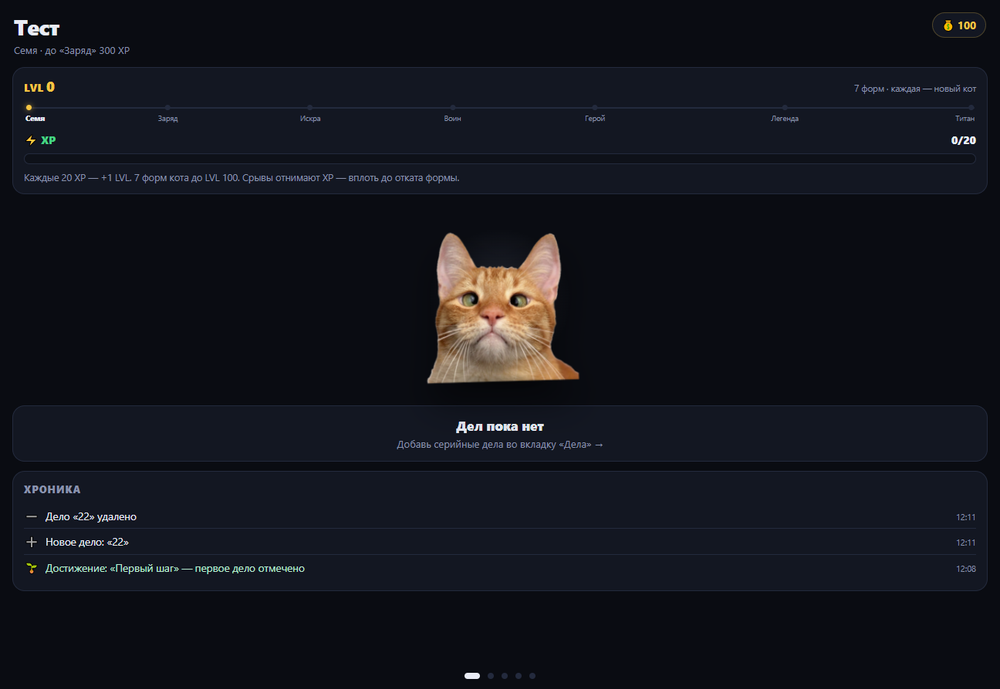

# EVO — жизнь как игра

[**▶ Играть в браузере (GitHub Pages, бесплатно)**](https://iamfil228.github.io/evo-game/) — открой ссылку на телефоне, «Поделиться → На экран “Домой”» (iPhone) или «Установить приложение» (Android) — и игра появится иконкой, как настоящее приложение.



Игра-трекер против прокрастинации. Твой аватар растёт в уровнях: дела дают XP, прокрастинация отнимает — вплоть до отката уровня и формы. Каждые 20 XP — новый уровень, а 7 форм кота — вехи на пути от Семени до Титана (LVL 100). Баллы тратятся в магазине мотиваций на реальные награды, большие мечты копятся в реальных деньгах. Вертикальный PWA: 5 экранов, переключение свайпами как на главном экране iPhone. Данные живут только у тебя — никаких серверов и аккаунтов.

## Как это работает

- 🧬 **Аватар и эволюция** — 7 форм-котов: Семя → Заряд → Искра → Воин → Герой → Легенда → Титан (котёнок → гигачад). Формы — вехи на пути 100 уровней: LVL 0 / 15 / 30 / 45 / 60 / 80 / 100. После Титана уровни продолжают расти. Будущие формы в «Зале эволюции» скрыты — интрига! Достигнутое остаётся навсегда
- ⚡ **XP и LVL** — дела дают XP, срывы отнимают: XP может уйти в минус, и уровень (вместе с формой) откатится назад. Дно — Семя (LVL 0), ниже не уронишь. Каждые 20 XP — +1 LVL (это ~3–4 дела). Кот-аватар красиво «висит в воздухе» с лёгким наклоном, свечение меняется с ростом формы
- 💰 **Баллы** — за каждое дело. Тратятся только в магазине
- 📋 **Дела серийные** — ежедневные привычки (до 12): эмодзи, серия 🔥, +5 XP и 💰 за выполнение (цену назначаешь ты — баллы отражают ценность дела), бонус до +10 💰 за длинную серию. Дни недели настраиваются: дело обязательно только в выбранные дни, в остальные серия спит и не ломается. Забыл вчера — кнопка «↺ Догнать вчера» спасёт серию
- 🎯 **Недельный челлендж** — план дел на неделю (растёт вместе с числом серийных дел: от 10 до 50). Закрыл — приз в 💰. Спонтанные тоже считаются
- ⚡ **Дела спонтанные** — сделал что-то полезное вне списка — запиши: +3 XP и +5 💰. Награда — за первые 5 записей в день, дальше записи идут в историю без награды
- 💔 **Пенальти** — потерял серию: −(3 + серия/2) XP (до 15). День без единого дела: −5 XP
- 🛡️ **Артефакты** — Щит серии (50 💰, максимум 3, расходуется автоматически при пропуске) и Зелье XP (40 💰, +20 XP сразу, не чаще 1 в день)
- 🎁 **Магазин мотиваций** — сам наполняешь реальными наградами и сам назначаешь цену в баллах. Покупка = дофамин за честно заработанные баллы. Награды раскладываются по категориям с минимальной ценой: 🍬 Мелочь, а приятно (от 100), 🍔 Ням-Ням (от 200), 🎡 Развлечения (от 300), 📱 Гаджеты (от 500), ✨ Остальное (от 100). Отметь 🎯 — и копи на большую цель, прогресс всегда перед глазами
- 💭 **Мечты — копилки в реальных деньгах** — путешествие, машина, жильё за монеты не покупаются. Отдельный экран-финансы: цель в рублях, пополнения с историей, общий прогресс по всем мечтам. Большие цели заслуживают настоящего накопительного счёта
- 🏅 **Достижения и титулы** — 13 бейджей за вехи (серии, формы, сотни дел, мечты, покупки). После Титана каждые +25 уровней — новый титул: Титан II, Титан III…
- 🔥 **Общая серия** — дни, когда сделано хотя бы одно дело (серийное или спонтанное)
- 🔔 **Напоминание** — локальное уведомление вечером, если дела не сделаны (работает, пока приложение открыто; у установленного PWA — даже когда закрыто)
- 💾 **Экспорт/импорт** данных в JSON, офлайн-режим (service worker). Если бэкапа не было 14+ дней — приложение напомнит
- 🎉 **Конфетти** при эволюции формы и закрытой мечте

## Экраны (свайпы влево/вправо, точки внизу)

1. **Аватар** — шкала LVL с отметками форм, XP-бар, аватар, статус сегодня, хроника событий
2. **Дела** — серийные и спонтанные
3. **Магазин** — артефакты, твои награды по категориям, история покупок
4. **Мечты** — копилки в реальных деньгах: цель, пополнения, прогресс
5. **Профиль** — статистика, достижения, дела за 14 дней, зал эволюции, настройки

## Запуск на ноутбуке

**Быстрый старт:** открой `index.html` двойным кликом в Chrome/Edge.

**Полный режим (установка как приложение + офлайн):**

```powershell
# если установлен Node.js
node server.js

# или
npx --yes serve .
```

Открой `http://localhost:8080` → значок **«Установить приложение»** в адресной строке.

## Установка на iPhone

1. Выложи папку на любой HTTPS-хостинг (GitHub Pages, Netlify, Vercel — бесплатно).
2. В Safari открой сайт → **Поделиться → «На экран “Домой”»**.
3. Иконка на рабочем столе, полноэкранный режим, данные в localStorage.

## Установка на Android

1. Открой сайт в Chrome → Chrome сам покажет баннер **«Установить приложение»** (или меню ⋮ → «Установить приложение» / «Добавить на главный экран»).
2. Можно нажать кнопку **«📲 Установить приложение»** прямо в Профиль → Настройки — она появляется автоматически, когда Chrome готов к установке.
3. Приложение встанет как обычное: иконка в меню, полноэкранный режим без адресной строки, офлайн-работа через service worker.

> 💡 На Android уведомления работают даже лучше, чем на iPhone: установленное PWA может получать их, пока Chrome живёт в фоне.

## Если нужен «настоящий» APK

PWA достаточно для личного использования. Если захочется отдельный APK/AAB (например, для Google Play):

1. Выложи приложение на HTTPS-хостинг.
2. Зайди на **pwabuilder.com**, вставь ссылку — сервис сгенерирует подписанный Android-пакет (обёртка TWA над тем же веб-приложением).
3. Альтернатива для ручной сборки — утилита **@bubblewrap/cli** от Google.

**Перенос между устройствами** (iPhone ↔ Android ↔ ПК): Настройки → «Экспорт» на старом, «Импорт» на новом.

> ⚠️ Данные хранятся в браузере. Очистка данных сайта = потеря аватара. Пользуйся «Экспорт» в настройках.

## Файлы

| Файл | Назначение |
|---|---|
| `index.html` | разметка 4 экранов + онбординг |
| `styles.css` | тёмная тема, свайп-страницы (scroll-snap) |
| `app.js` | вся логика: ХП, серии, эволюция, магазин, пенальти |
| `sw.js` | офлайн-кэш и доставка уведомлений |
| `manifest.webmanifest` | метаданные PWA |
| `server.js` | мини-сервер для локального запуска (без зависимостей) |
| `icon-192.png` / `icon-512.png` | пиксельные иконки |
| `design/ai/cat-1.png … cat-7.png` | аватары 7 стадий (мемные коты, прозрачные PNG) |

## Баланс (можно менять в `app.js`)

| Параметр | Значение |
|---|---|
| Стадии (формы кота) | вехи на 100 уровней: LVL 0 / 15 / 30 / 45 / 60 / 80 / 100 |
| Уровень | каждые 20 XP = +1 LVL (до Титана — 100 уровней, дальше без ограничений) |
| Серийное дело | +5 XP + цена дела 💰 (по умолчанию 10, бонус до +10 💰) |
| Спонтанное дело | +3 XP +5 💰 (награда за первые 5/день, дальше записи без награды) |
| Потеря серии | −(3 + ⌈серия/2⌉) XP, максимум 15 |
| Пустой день | −5 XP |
| Откат | XP уходит в минус → уровень и форма откатываются (дно — Семя, LVL 0); зал хранит историю форм |
| Щит / Зелье | 50 💰 / 40 💰 (зелье — максимум 1 в день) |
| Мечты | копятся в реальных деньгах (₽), монеты не участвуют |
| Недельный челлендж | план = 5 × число серийных дел (10–50); приз = план × 2 💰; раз в неделю |

## Лицензия

MIT — играй, меняй, распространяй свободно. Подробности в [LICENSE](LICENSE).
